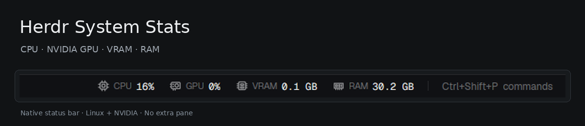

# Herdr System Stats

**CPU, NVIDIA GPU, VRAM and RAM—right in Herdr's existing status bar.**

A small, native [Herdr desktop](https://herdr.dev/) mod for Linux. Four SVG icons,
readable values and no extra monitoring pane. Keeps the machine, branch, agents
and Commands controls from the standard footer.



## What you get

- CPU utilization and NVIDIA GPU load as percentages.
- VRAM and RAM used in **decimal GB**; totals in hover tooltips.
- Theme-aware icons and monospaced values, with a warning colour at 90%.
- Refreshes every 2 seconds. Missing readings show `—`, not stale values.
- No npm dependencies, background service or network requests.

**Scope:** always the local computer, even in an SSH workspace. GPU readings
describe the first NVIDIA GPU returned by `nvidia-smi`, not an Intel integrated GPU.

## Requirements

- Herdr desktop; tested with **0.1.15 on Linux x86-64**.
- Linux `/proc/stat` and `/proc/meminfo`.
- For GPU/VRAM: the NVIDIA driver and `nvidia-smi` available on Herdr's PATH.
  CPU/RAM still work when NVIDIA readings are unavailable.
- Node.js 18+ only for developer tests—not needed to run the mod.

AMD/Intel GPU metrics and macOS/Windows sampling are **not implemented**.
Frequent NVIDIA queries may affect laptop power use; battery impact is not benchmarked.

## Install with your agent

Ask the agent in Herdr:

> Read ~/.config/herdr-app/AGENTS.md, then add this mod:
> https://github.com/zrmnelson/herdr-system-stats.
> Read the recipe and source first. Preserve my current layout and panels;
> replace only the standard status footer. Explain the Linux/NVIDIA requirements.

[RECIPE.md](RECIPE.md) is the full build/install brief. Mods are trusted executable
code: this one reads the two local `/proc` files and runs `nvidia-smi` every 2s
with a 1500ms timeout. It does not run a shell, send data out or launch terminals.

## Manual installation

1. Clone or download this repository and inspect its files.
2. Read your own `~/.config/herdr-app/AGENTS.md`. Back up your active layout.
3. Copy **only** `mods/system-status/` into your Herdr app home's `mods/`.
   Never overwrite an existing mod. If the name is taken, rename the folder
   and every `mods/system-status/` asset reference in `main.js` consistently.
4. Check the copied mod:
   ```sh
   herdr-app check ~/.config/herdr-app/mods/system-status
   ```
5. If using a shipped layout, duplicate it first using the command palette's
   **Duplicate layout** action, or `layout.clone` with its actual name.
   Edit only the personal copy. In that layout's existing **standard status
   block**, change `content.mod` from `workspace-status` to `system-status`.
   Keep its 28px height and all unrelated panels/settings.
6. Save, wait at least 4 seconds and inspect the footer. Run
   `herdr-app status` and ensure there are no mod/layout errors.

`mod.json` deliberately uses `"place": "none"`: copying the folder alone does
not show it. This replaces the standard footer rather than adding a duplicate
bar. If you already have a custom footer, merge deliberately or ask before
replacing it; do not discard its features.

No layouts, keybindings or user settings are bundled or overwritten.
Use your actual app home if you set `HERDR_APP_HOME`.

## Remove / roll back

Restore that status block's previous `content.mod` value (usually
`workspace-status`). The mod's timer stops when its block is removed.
You can then delete its folder. Do **not** restore an entire old layout over
newer panel customizations.

## How the readings work

| Metric | Source / calculation |
|---|---|
| CPU | Interval delta from `/proc/stat`; excludes idle and I/O wait, does not double-count guest time. First interval shows `—`. |
| GPU | First NVIDIA device's `utilization.gpu` from `nvidia-smi`. |
| VRAM | NVIDIA `memory.used`; MiB converted to bytes then decimal GB. |
| RAM | `MemTotal - MemAvailable` from `/proc/meminfo`, displayed in decimal GB. |

The query is `nvidia-smi --query-gpu=utilization.gpu,memory.used,memory.total --format=csv,noheader,nounits`.
No overlapping refreshes. GPU failure does not prevent CPU/RAM updates.
Values may differ from monitors that use GiB or count cache differently.

On narrower footers the branch/machine label and long Commands hint compact;
extremely narrow windows can clip content. Hover text retains detail.
There is no multi-GPU selector or remote-host sampler in this version.

## Development and checks

No install step or package manager is needed:

```sh
node mods/system-status/test_logic.mjs
node --experimental-vm-modules tests/runtime.test.mjs
herdr-app check mods/system-status
```

The VM-modules test emits Node's experimental-feature warning. It executes the
real mod against a small host bridge fixture to test polling, failure handling,
rendered values, local scope and bundled assets. It is not a substitute for
Herdr's native check and visual testing. The native check renders the initial
state only; verify later samples in the actual app.

## Contributing and ownership

Issues and pull requests are welcome. Only **@zrmnelson** merges changes into
this repository. Public visibility permits forks and proposed pull requests;
it does not grant write access. CI has read-only permissions and does not merge.

## License and attribution

Apache-2.0 for the code, documentation and four metric icons. The footer derives
from Herdr app v0.1.15. Three inherited navigation icons carry Lucide/Feather
ISC/MIT notices. See [LICENSE](LICENSE), [NOTICE](NOTICE) and
[the icon license](licenses/LICENSE-Lucide.txt).

Community mod; not affiliated with or endorsed by Herdr.
