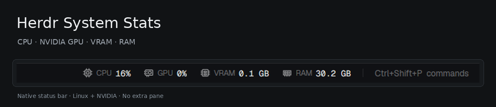

# Herdr System Stats

Keep an eye on your machine without leaving your agent: CPU and NVIDIA GPU load,
VRAM and RAM used, with four native SVG icons in the existing bottom status row.
The standard machine/branch/agents information and Commands shortcut stay in place.



## What you see

A 28px footer with the theme's `chrome` background and a 1px `border` top rule.
14px horizontal padding, 11.8px text. Machine, optional branch and agent count
on the left; flexible space; CPU, GPU, VRAM and RAM on the right, followed by a
divider and Commands.

Each metric has a 14px SVG, muted 10.5px uppercase label and brighter Geist Mono
value. CPU/GPU are whole percentages; VRAM/RAM are used decimal GB with one
decimal place. Metric groups are 18px apart. Icons/values use `blocked` at 90%
busy/full. Hover explains local scope, memory totals, units and refresh cadence.

## How it behaves

Samples every 2000ms. First CPU interval and unavailable/invalid data show `—`.
NVIDIA timeout/failure clears GPU/VRAM; CPU/RAM continue. No overlapping polls.

The readings **always describe this computer**, not the selected SSH host.
GPU means the first NVIDIA device returned by the driver, not integrated graphics.

The agent count covers all statuses. A blocked agent adds the inherited
`needs you` indicator; working/done/idle retain the standard aggregate count.
The Commands text derives from the person's actual global palette keybinding;
clicking opens `app.palette`. It is not a hardcoded shortcut.

Branch labels show at footer widths >=1100px and machine labels >=800px;
the full Commands shortcut shows at >=1000px, otherwise just `commands`.
Labels truncate; extremely narrow footers may clip. No custom animation.

## Built from

One native GPUI `View`, `h_flex`, `div` and tinted `svg`.
`main.js` contains state, refresh and footer rendering; `logic.mjs` contains
pure CPU/RAM/NVIDIA parsing and unit formatting; `test_logic.mjs` checks it.
All seven icon assets live under `mods/system-status/`.

Herdr APIs: `spaces`, `agents`, `theme`, `keys`, `window`, `run`,
`readTextFile`, `exec`; native `cx.timer.every`, `cx.spawn`, `cx.notify`.
Reads local `/proc/stat` and `/proc/meminfo` and executes:

```sh
nvidia-smi --query-gpu=utilization.gpu,memory.used,memory.total --format=csv,noheader,nounits
```

The executable resolves from PATH; 1500ms timeout. No shell, network requests,
persistent daemon, Node runtime dependency or terminal creation.
CPU excludes idle/iowait; RAM is total minus available. NVIDIA MiB are converted
to bytes and then decimal GB. Do not label GiB as GB.

### Installation into an existing layout

Read the recipient's installed app guide and every package file first. Disclose
the local reads/program above. Find their actual active layout; do not assume
a particular personal layout name.

Back up that layout; if shipped, use `layout.clone`/Duplicate layout before
changing structure. Copy the mod folder without overwriting a name collision.
If renaming it, rewrite its self-referenced asset paths and layout reference.
Run `herdr-app check` on the installed copy.

`mod.json` is `{"place":"none"}`: it must not auto-dock a second footer.
Replace **only** the existing standard status block's `content.mod` with
`system-status`. Retain its 28px height and the person's unrelated panels,
keys, theme, settings and terminals. If a different custom footer is present,
ask before replacing it or deliberately merge it. Save to hot-reload.

Rollback restores only the previous footer mod reference, not an old complete
layout over subsequent changes. The package has no `layouts/` or key snippet.

## Watch out

- Tested with Herdr desktop0.1.15 on Linux x86-64. macOS/Windows samplers and
  AMD/Intel GPU readings are not implemented; absent NVIDIA data is `—`.
- NVIDIA driver/`nvidia-smi` must be on Herdr's PATH. Integrated-GPU-only systems
  still get Linux CPU/RAM. Multi-GPU displays only the first NVIDIA device.
- Sampling may influence GPU power/battery use; not benchmarked.
- New metric icons are original; inherited footer/nav icons and source are
  attributed in NOTICE and licenses/LICENSE-Lucide.txt. Preserve notices.
- Mods are trusted executable code. Never copy a private app home, session logs,
  unrelated mods, generated declarations or full-window private screenshots
  into a public package.
- The check loads/renders the initial state; it does not prove later async data.
  The runtime fixture test cannot prove actual GPUI layout or hover behavior.

## Done when

1. `node mods/system-status/test_logic.mjs` passes.
2. `node --experimental-vm-modules tests/runtime.test.mjs` passes, including
   PATH lookup, nonoverlap, local-only execution, rendered data and GPU failure.
3. `herdr-app check <installed-mod-folder>` passes and app status has no errors.
4. After at least two samples, all four readings/icons appear on supported
   hardware; GPU/VRAM match the NVIDIA query and RAM uses total minus available.
5. Existing machine/agent controls and Commands remain usable, unrelated panels
   remain intact, and restart/rollback preserve the personal layout.
